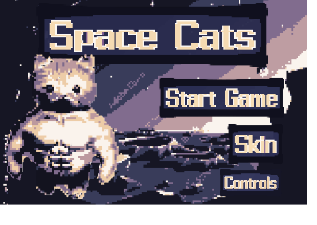

# Space Cats

A top-down roguelike for the browser, built with p5.js. You play a cat fighting through four
cheese-themed planets to rescue his kidnapped parents from the Rat King.

<!-- TODO: replace with the GitHub Pages URL once Pages is enabled on this repo -->
**Play it:** _link coming soon_



## Features

- **Four planets**, each with its own tile map, soundtrack and rat variants: Nacho,
  Blue Cheese, Parmesan and Cheesecake. The first three are visited in random order and
  Cheesecake, the boss planet, is always last.
- **Fight rooms** that lock you in behind spike walls until every enemy is defeated.
- **Melee and ranged combat**: a sword per planet, plus a bow that fires toward the mouse
  cursor. Hits show damage numbers, with screen shake and a hit flash on taking damage.
- **Chests and a three-slot inventory**: pick up, swap, select and drop items.
- **Potions** that restore health or temporarily boost attack.
- **Three lives**, with a game-over screen and a victory screen that reports your clear time.
- **Selectable cat skins**, a narrated story slideshow, and transition screens between planets.

## Controls

| Action | Key |
| --- | --- |
| Move | `W` `A` `S` `D` or arrow keys |
| Attack / fire bow | `Space` (the bow aims at the mouse cursor) |
| Open chest | `E` |
| Select chest item | `9` / `0` |
| Pick up or swap selected item | `Enter` |
| Select inventory slot | `1` `2` `3` |
| Drop selected item | `Backspace` |
| Use potion | `Shift` |

## Built with

- [p5.js](https://p5js.org/) and p5.sound for rendering, input and audio
- [Tiled](https://www.mapeditor.org/) for level design
- Plain JavaScript, HTML and CSS, with no build step

## Project structure

```
index.html        production page (served by GitHub Pages)
sketch.js         production game code
style.css
assets/
  images/         sprites, tilesets and UI art
  audio/          music, sound effects and narration
libraries/        p5.js and p5.sound
maps/             level data loaded by the game (exported from Tiled)
tiled/            Tiled source files for the maps and tilesets
dev/              development build
docs/             README images and project documents
```

### Production and development builds

The team kept two copies of the game code throughout the project:

- `sketch.js` at the repo root is the **production** build, the one that is published.
- `dev/sketch.js` is the **development** build, where new work was tried first. It uses
  testing values (for example, a much higher player attack so levels can be cleared quickly).

Changes were promoted from `dev/` to production by hand once they were working. Both builds
share the same assets, maps and libraries.

## Running locally

The game loads images and audio over HTTP, so it needs a local web server rather than
opening `index.html` directly from disk.

```sh
git clone <this repo's URL>
cd <repo folder>
python -m http.server 8000
```

Then open:

- <http://localhost:8000/> for the production build
- <http://localhost:8000/dev/> for the development build

The VS Code Live Server extension works too, as long as it serves the repo root.

## Team and contributions

Space Cats was built by a team of five for CS 345, an application development course at
James Madison University, in Spring 2026. Everyone worked across the codebase; the areas
below are where each person did most of their work.

<!-- TODO: drafted from commit history; have each teammate confirm their own entry -->

### Devran Turson

- **Player movement and animation**: sprite sheets, idle and walk cycles, and WASD and
  arrow-key input
- **Enemy presentation and behavior**: rat sprite-sheet animation, a distinct rat for each
  planet, the attack lunge, room boundaries, and combat balancing
- **Menus and screens**: title page, skin-selection page, controls page, game-over and
  victory screens, and the transition screens between planets
- **HUD, feedback and audio**: pixel-art hearts and inventory bar, damage-number popups,
  the item equip animation, per-planet soundtracks, and sound effects
- **Release management**: promoting tested changes from the development build to production

### Toshura Washington

- **Level design and map system**: built all four maps in Tiled and the code that loads them,
  including spawn points and enemy placement
- **Fight rooms**: spike walls, the locked boss room, and the "map cleared" sequence
- **Planet progression**: random planet order, transitions, and difficulty scaling
- **Boss fight**: boss spawning and the charge attack
- **Game feel and story**: camera shake, hit indication, knockback, attack-swing timing,
  and the backstory slideshow

### Nicole Band

- **Title and menu art**: the Space Cats title, menu buttons, and skin-selection graphics
- **HUD art**: hearts, the interface frame, the inventory bar, and damage-number digits
- **Item and level art**: weapon icons including the bow, and the name banner for each planet
- **Screen graphics**: controls-page key images, and the game-over and map-cleared screens

### Kripa Bishwakarma

- **Combat foundations**: the first enemy movement, enemy and player attacks, and attack ranges
- **Bow and arrows**: ranged-weapon mechanics and the slash animation for melee attacks
- **Items**: swords, health potions, and the timed strength-boost potion

### Darrin Annor

- **Inventory and chests**: picking up, selecting, swapping and dropping items, and opening chests
- **Sound and narration**: page music and sound effects, and voice-over for the story slides

This repository is a reorganized copy of the team's class repository, with the full commit
history preserved.

## Credits

<!-- TODO: fill in sources for third-party art and audio before publishing -->

- Game engine: [p5.js](https://p5js.org/) (LGPL 2.1)
- Snow tileset (`assets/images/FE8 - Snowy Bern.png`): from _Fire Emblem: The Sacred Stones_,
  © Nintendo / Intelligent Systems. Used for a non-commercial class project.
- Other tilesets, sprites, music and sound effects: _sources to be added_

## License

The source code is licensed under the [GNU General Public License v3.0](LICENSE). Third-party
art and audio remain the property of their respective owners and are not covered by that license.
